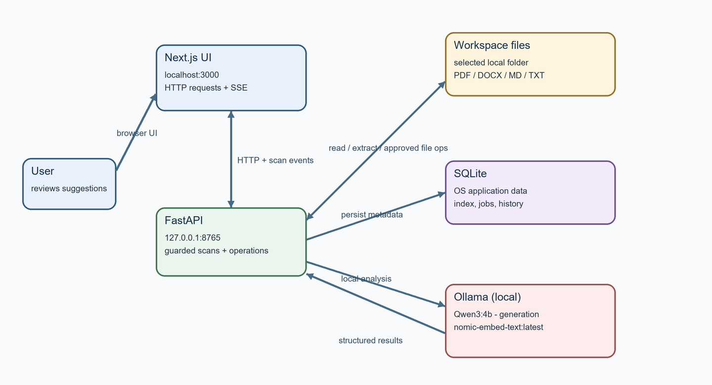

# Moss — The Digital Backlog Gardener

Moss is a local-first document organization assistant. It indexes supported
documents, finds related files, extracts evidence-backed tasks and deadlines,
and proposes organization changes. **You remain in control:** Moss never moves
or renames a file without explicit approval and execution.

> Fully local, offline-capable, and privacy-preserving. All 12 implementation
> phases are complete and verified with local unit, integration, and E2E browser tests.

## Features

- Select a local workspace and safely browse its directories.
- Scan PDF, DOCX, Markdown, and plain-text documents with extraction caching.
- Identify related files, exact duplicates, and near-duplicate candidates.
- Extract tasks, deadlines, decisions, and follow-ups with source evidence.
- Review, approve, edit, execute, and undo supported file-operation suggestions.
- Track scan progress and results in the local web interface.

## Privacy and safety

- The FastAPI service binds to loopback (`127.0.0.1:8765`) by default.
- Document analysis uses Ollama on the same machine; Moss does not send
  document contents to a cloud model or automatically download models.
- Filesystem operations are restricted to the selected workspace and require
  approval followed by a separate execution step.
- The SQLite database is stored in the operating-system application-data
  directory by default, outside the scanned workspace.
- Model output is untrusted and cannot authorize filesystem changes.

## Requirements

- Python 3.11 or newer
- Node.js 20.9 or newer and npm
- Ollama running locally with the following tags already installed:
  - Generation: `Qwen3:4b`
  - Embeddings: `nomic-embed-text:latest`

Moss never runs `ollama pull`. See [Local model setup](docs/model_setup.md)
before scanning documents.

## Development setup

See [Development setup](docs/setup.md) for Windows, macOS, and Linux.

Quick start on Windows PowerShell:

```powershell
cd backend
python -m venv .venv
.\.venv\Scripts\Activate.ps1
python -m pip install -r requirements-dev.txt
uvicorn moss.main:app --reload --host 127.0.0.1 --port 8765
```

In a second terminal:

```powershell
cd frontend
npm ci
npm run dev
```

Open `http://localhost:3000`. The Next.js frontend connects to the local API
at `http://127.0.0.1:8765` by default. Set `NEXT_PUBLIC_MOSS_API_URL` before
starting the frontend to use a different API origin.

## Demo workspace

Generate 30 deterministic, fabricated Markdown documents grouped into three
synthetic topics:

```powershell
python scripts/generate_demo_data.py
```

The default output is `demo_workspace/`. Select that folder as the workspace
in Moss to explore the interface. The generator is safe to re-run: it accepts
existing files only when their contents match the generated demo, and refuses
to overwrite different content. This demo is not a model-quality evaluation.

The separate synthetic metric harness can be run with:

```powershell
python scripts/evaluate_synthetic.py
```

Its NMI and action-item F1 scores validate deterministic mock metrics only;
they are not real-model quality measurements. See [Testing and evaluation](docs/evaluation.md)
for the verified results and benchmark limits.

The [browser workflow GIF](docs/demo-workflow.gif) and
[screenshots](docs/screenshots/) illustrate the UI with isolated synthetic
Playwright API fixtures. They do not represent a live model scan.

## Architecture



See [Architecture](docs/architecture.md) for the full data flow and safety
boundaries.

## Checks

Backend (from `backend/`):

```powershell
python -m pytest
ruff check moss tests ..\scripts
mypy moss ..\scripts
```

Frontend (from `frontend/`):

```powershell
npm run typecheck
npm run lint
npm run build
```

## Documentation

- [Development setup](docs/setup.md)
- [Local model setup](docs/model_setup.md)
- [Troubleshooting](docs/troubleshooting.md)
- [Architecture](docs/architecture.md)
- [API reference](docs/api_reference.md)
- [Testing and evaluation](docs/evaluation.md)
- [Demo walkthrough](docs/demo.md)
- [Architecture decisions](docs/decisions.md)
- [Third-party license inventory](THIRD_PARTY_LICENSES.md)
- [Local DEV Community article draft](docs/dev-community-article-draft.md)
- [Implementation plan](implementation_plan.md)

## Project status

All 12 phases of implementation are complete and verified. Local scanning,
AI classification, embeddings, similarity clustering, action-item extraction,
recommendations, and reversible file operations are fully implemented and
tested locally. GitHub publishing and release tagging remain owner-managed.
