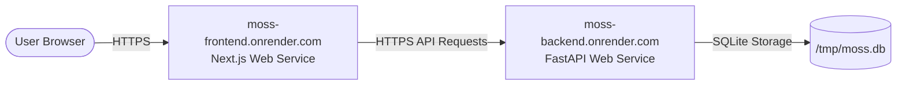

# Deploying Moss on Render

This guide provides end-to-end instructions for deploying the **Moss** project on [Render](https://render.com).

Moss consists of two core components:
1. **FastAPI Backend**: Python web service providing domain APIs, health checks, background job queues, and AI integration.
2. **Next.js Frontend**: Modern React/Next.js client interface with responsive dark/light theme, interactive workspace management, and instant presentation demo mode.

---

## Architecture on Render



---

## Method 1: 1-Click Blueprint Deployment (Recommended)

The repository includes a ready-to-use [`render.yaml`](file:///c:/MOSS_HACKTOBERFEST/render.yaml) file. This automatically configures both services and connects their environment variables with zero manual wiring.

### Steps:

1. **Push your code to GitHub**:
   Ensure your changes including `render.yaml` are pushed to your GitHub repository:
   ```bash
   git add render.yaml backend/requirements.txt backend/Dockerfile frontend/Dockerfile docs/RENDER_DEPLOYMENT.md
   git commit -m "feat(deploy): add Render blueprint and deployment configurations"
   git push origin main
   ```

2. **Log in to Render**:
   - Go to [dashboard.render.com](https://dashboard.render.com/) and sign in with GitHub.

3. **Create a Blueprint Instance**:
   - Click the **New +** button in the top navigation bar.
   - Select **Blueprint**.
   - Connect your GitHub repository (`HACKTOBERFEST_MOSS`).
   - Give your blueprint instance a name (e.g. `moss-production`).
   - Branch: `main`.

4. **Deploy**:
   - Render will parse `render.yaml` and display the two services:
     - `moss-backend` (Python Web Service)
     - `moss-frontend` (Node.js Web Service)
   - Click **Apply**.
   - Render will build both services in parallel and provide live deployment logs.

5. **Access Your Live App**:
   - Once both deployments turn green (**Live**), click on the `moss-frontend` URL (e.g. `https://moss-frontend.onrender.com`).
   - The app will load with the instant presentation demo workspace pre-loaded.

---

## Method 2: Manual Web Service Deployment via Dashboard

If you prefer to configure each service manually in the Render dashboard:

### Step 2.1: Deploy the Backend Web Service

1. On the Render Dashboard, click **New +** > **Web Service**.
2. Select your repository.
3. Configure the backend service:
   - **Name**: `moss-backend`
   - **Region**: Choose closest to you (e.g. `Oregon (US West)` or `Frankfurt (EU)`)
   - **Branch**: `main`
   - **Root Directory**: `backend`
   - **Runtime**: `Python 3`
   - **Build Command**: `pip install -r requirements.txt`
   - **Start Command**: `uvicorn moss.main:app --host 0.0.0.0 --port $PORT`
   - **Plan**: `Free`
4. Add **Environment Variables** in the Advanced section:
   | Key | Value | Purpose |
   |---|---|---|
   | `PYTHON_VERSION` | `3.11.9` | Matches project Python version |
   | `MOSS_DATABASE_PATH` | `/tmp/moss.db` | Path for database file |
   | `MOSS_LOG_LEVEL` | `info` | Structured logging |
5. Click **Create Web Service**.
6. Copy the generated backend URL (e.g. `https://moss-backend-xyz.onrender.com`).

---

### Step 2.2: Deploy the Frontend Web Service

1. Click **New +** > **Web Service**.
2. Select the same repository.
3. Configure the frontend service:
   - **Name**: `moss-frontend`
   - **Region**: Same region as backend
   - **Branch**: `main`
   - **Root Directory**: `frontend`
   - **Runtime**: `Node`
   - **Build Command**: `npm install && npm run build`
   - **Start Command**: `npm start -- -p $PORT`
   - **Plan**: `Free`
4. Add **Environment Variables**:
   | Key | Value | Purpose |
   |---|---|---|
   | `NODE_VERSION` | `20.18.0` | Node.js LTS version |
   | `NEXT_PUBLIC_MOSS_DEMO_MODE` | `true` | Enables instant presentation mode |
   | `NEXT_PUBLIC_MOSS_API_URL` | `https://moss-backend-xyz.onrender.com` | Backend URL from Step 2.1 |
5. Click **Create Web Service**.

---

### Step 2.3: Link CORS Origins

Go back to `moss-backend` on the Render dashboard:
1. Navigate to **Environment**.
2. Add or update `MOSS_CORS_ORIGINS`:
   - Key: `MOSS_CORS_ORIGINS`
   - Value: `https://moss-frontend-xyz.onrender.com` (your actual frontend URL)
3. Click **Save Changes** (Render will redeploy the backend in a few seconds).

---

## Method 3: Docker-Based Deployment

Dockerfiles are provided in both `backend/Dockerfile` and `frontend/Dockerfile`.

If you prefer containerized deployment:
1. When creating the Web Service on Render, choose **Docker** runtime instead of Python/Node.
2. Specify the **Dockerfile Path**:
   - For backend: `./backend/Dockerfile` with Context: `./backend`
   - For frontend: `./frontend/Dockerfile` with Context: `./frontend`

---

## Free Tier Tips & Best Practices

1. **Spin-Down & Cold Starts**:
   - Render's free tier spins down web services after 15 minutes of inactivity.
   - The first request to a sleeping service takes ~30–50 seconds to wake up.
   - Once awake, response times are immediate.

2. **Presentation Demo Mode**:
   - Because Render free tier does not include a GPU, `NEXT_PUBLIC_MOSS_DEMO_MODE=true` is enabled by default.
   - This allows anyone visiting your deployed URL to immediately experience all features (18 documents, multi-stage scan, duplicates, collections, action items, recommendations, and 1-click undo) without running slow local model inference.

3. **Health Check Endpoint**:
   - Render health checks are configured to `/api/health`.
   - You can test backend availability directly at:
     ```
     https://<your-backend-url>.onrender.com/api/health
     ```
