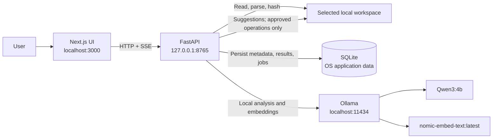

# Architecture Overview

Moss is a local-first application with a Next.js frontend, a FastAPI backend,
SQLite metadata storage, and Ollama for local language-model and embedding
calls. The browser connects to the API over loopback HTTP. Scan progress is
streamed with Server-Sent Events.

## Scan and recommendation flow

1. The user selects a workspace. The backend canonicalizes paths, limits
   directory browsing to the allowed root, and does not expose file contents
   through the browse API.
2. The user requests a scan. The background job discovers supported PDF,
   DOCX, Markdown, and text files, computes hashes, extracts text, and stores
   eligible extraction results in SQLite for cache reuse.
3. Document text and metadata are passed to the configured local Ollama
   service for structured classification, evidence-backed action extraction,
   and embeddings. Model responses are validated before persistence. Missing
   models or invalid responses are reported; analysis is not replaced with
   fabricated output.
4. Similarity and duplicate candidates are persisted and surfaced with
   recommendations for user review.
5. Recommendations that imply a filesystem change require separate approval
   and execution. The backend validates both source and destination against
   the active workspace, avoids overwriting existing destinations, records
   operation history, and supports undo where possible.

## Data and safety boundaries

- The FastAPI server and Ollama endpoint are restricted to loopback.
- Moss does not pull models or call a cloud model. Document content used for
  analysis stays on the machine and is sent only to the configured local
  Ollama service.
- SQLite stores indexing and application metadata outside the workspace by
  default, in the OS application-data directory.
- Document text and model output are untrusted input. Neither can authorize
  filesystem operations.
- Filesystem changes are guarded by canonical workspace paths and explicit
  user approval. Approval and execution are distinct actions.
- Job state is persisted for UI reporting, but in-process queued work does
  not automatically resume after a backend restart. Interrupted jobs are
  marked and can be followed by a cache-backed manual rescan.

## Runtime defaults

| Component | Default |
|---|---|
| Frontend | Next.js development server on `http://localhost:3000` |
| API | FastAPI on `http://127.0.0.1:8765` |
| Ollama | `http://localhost:11434` |
| Generation | `Qwen3:4b` |
| Embeddings | `nomic-embed-text:latest` |
| Database | SQLite under the OS application-data directory |

See [Architecture decisions](decisions.md) for the rationale and known
trade-offs.
