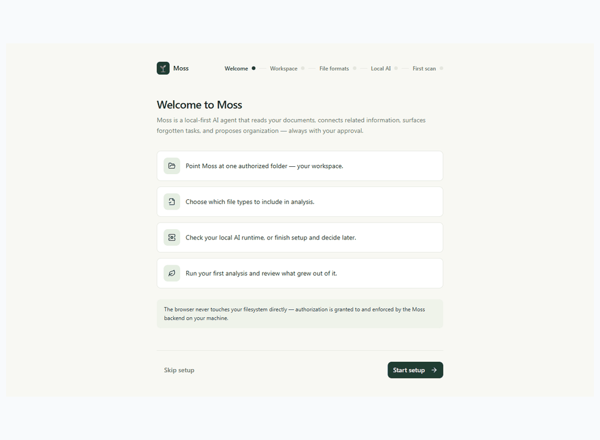

# Browser Demo Walkthrough



The animation and [individual screenshots](screenshots/) are captured from the
Playwright browser workflow. The test intercepts the API with deterministic
synthetic fixtures; it does not run a live backend, contact Ollama, or scan
real documents. Labels such as "Local AI ready" in these captures are fixture
responses, not a claim about the current machine's Ollama status.

The workflow exercises:

1. Workspace onboarding and permission confirmation.
2. Scan progress and completed-analysis summary.
3. Related-file navigation and action-item source evidence.
4. Duplicate review and recommendation approval.
5. File operation execution, activity history, and undo.

Recreate the screenshots from the repository root:

```powershell
cd frontend
npx playwright test e2e/workflow.spec.ts
```

The workflow is local and deterministic. It must not be presented as
validation of real-model classification, embedding quality, or offline
inference.
